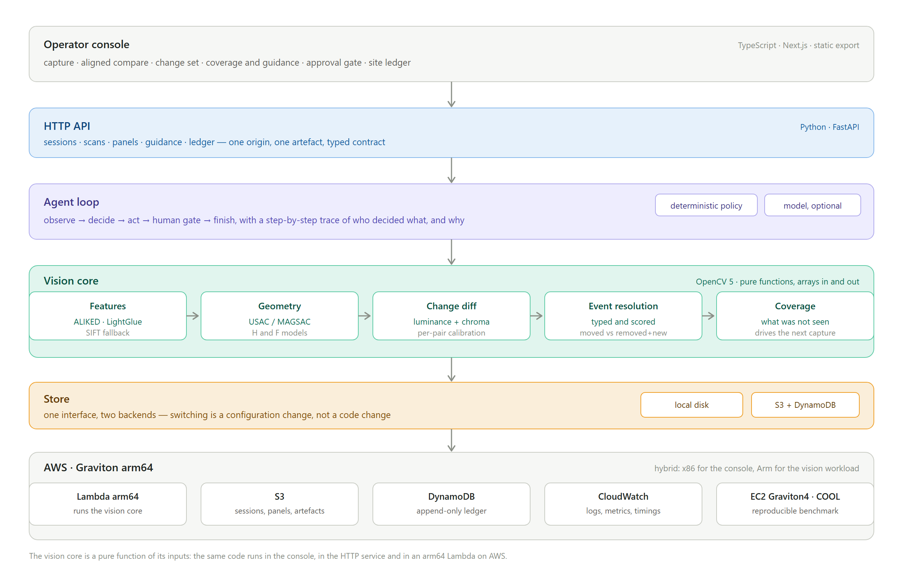

# STRATA — Technical Report

**Version control for the physical world.**

---

## 1. Summary

STRATA answers a question that people ask constantly and machines answer badly:
*what changed here since last time?*

Two photographs of the same place are never the same photograph. The camera
moves, the light shifts, the exposure drifts. Subtract them and you get the
difference between two cameras, not the difference between two moments. Every
edge appears twice; nothing is legible.

STRATA solves the problem in the order it has to be solved: register the two
visits into one canonical frame, normalise the photometry, detect what genuinely
differs, then resolve regions of difference into **typed events** — something
departed, something arrived, something moved, something was altered — each with
a confidence and the measurements behind it.

It then does the part most systems skip. It reports **what it did not see**.
Regions it could not observe well enough to compare are marked unresolved and
turned into a specific request for another capture, rather than being folded
into a confident "nothing changed". Nothing enters a site's history until a
person approves it.

The result is a record of a physical place with the same properties engineers
expect from a code repository: an immutable baseline, a diff against it, typed
changes, provenance for every claim, and an append-only history that includes
the scans that found nothing.

---

## 2. Problem and users

### 2.1 The problem

Physical spaces have no version control. Software has had it for two decades;
buildings, shelves, labs, and sites have clipboards.

The consequences are concrete and expensive:

| Domain | What is missing today | Cost |
|---|---|---|
| Retail and pharmacy | Shelf-state verification is a manual walk. Out-of-stocks and planogram drift are found late or not at all. | Labour hours per site per week; lost sales |
| Construction and facilities | Progress and snagging are "verified" by photo dumps nobody can compare reliably. | Rework; dispute resolution |
| Laboratories and regulated facilities | Equipment moved, missing, or altered; compliance evidence is anecdotal. | Audit findings |
| Insurance and claims | "What changed and when" is contested and expensive to establish. | Payout leakage; investigation cost |
| Agriculture | Per-plant change over weeks is unmeasured at scale. | Yield loss detected late |

Existing approaches fail for structural reasons:

- **Pixel or SSIM differencing** is meaningless under viewpoint change. The
  camera never returns to the same pose, so the difference is dominated by
  misregistration.
- **Photogrammetry and scan-to-BIM** need specialised capture and expensive
  processing, produce geometry without semantics, and say nothing about *what*
  changed.
- **Vision-language "spot the difference"** has no geometry and no metric. It
  cannot say how far something moved, and it cannot be reproduced.
- **Manual audit** is slow, subjective, and leaves no verifiable trail.

### 2.2 Users

- **Site and facilities operators** who need a defensible record of a space.
- **Auditors and compliance officers** who need evidence, not assurances.
- **Field technicians** who need to know whether the thing they are looking at
  matches the record.
- **Developers** who need the capability as an API rather than a dashboard.

The system is designed for the operator's real constraint: they are holding a
phone, they have one chance to capture, and they do not know in advance which
part of the scene will matter. That constraint is why capture guidance is a
first-class output rather than a diagnostic.

---

## 3. System architecture



Four layers, each with one responsibility:

1. **Operator console** — TypeScript, Next.js, statically exported. Capture,
   aligned compare, change set, coverage and guidance, approval gate, ledger.
2. **HTTP API** — Python, FastAPI. Sessions, scans, panels, guidance, ledger.
   Serves the built console from the same origin, so the deployment is one
   artefact and one URL rather than two that must be kept in step.
3. **Agent loop** — the perceive → decide → act → gate cycle, with a trace.
4. **Vision core** — OpenCV 5. Pure functions: arrays in, arrays and JSON out.
   No filesystem, no network, no model download at call time.

The purity of the vision core is a deliberate architectural constraint, not a
style preference. It is what lets the identical code run in the console process,
in the HTTP service, and inside an Arm container on AWS without a conditional
anywhere. It also makes the pipeline testable without fixtures on disk.

Storage is behind one interface (`Store`) with two implementations: local disk
and S3 + DynamoDB. Switching is a configuration change (`STRATA_EXECUTOR=aws`),
not a code change.

---

## 4. The vision pipeline (OpenCV 5)

Everything below runs on **OpenCV 5.0.0** (`opencv-contrib-python==5.0.0.93`).

### 4.1 Feature extraction and matching

The default backend is the neural pair introduced in OpenCV 5:

- **`cv::ALIKED`** — a CNN keypoint detector and descriptor
  (`aliked-n16rot-top2k-640.onnx`). Configured for up to 2000 keypoints with
  128-dimensional descriptors.
- **`cv::LightGlueMatcher`** — attention-based matching with a confidence score
  per correspondence. LightGlue is keypoint-aware, so the matcher is given
  spatial context via `setPairInfo(queryKpts, trainKpts, querySize, trainSize)`
  before `match()`. It supports `k=1` only; `knnMatch` with `k>1` raises.

Both are OpenCV 5 additions with no equivalent in OpenCV 4 or in `opencv.js`,
which is why the vision core is Python rather than TypeScript.

Three properties of this pairing matter for the product:

**It is robust to appearance change.** Neural descriptors survive the lighting
and white-balance drift between two visits far better than hand-crafted ones,
which is the difference between registering a shelf on a Tuesday and the same
shelf under fluorescent light on a Friday.

**It is fast enough to be interactive but slow enough to be worth optimising.**
Measured on the development machine (x86, CPU only, 12 cores): ALIKED
detect-and-describe is ~1.5–1.7 s per 960×720 frame, LightGlue matching is
~5.2 s per pair, and a full scan is 14.3 s median. That is the honest cost of
the accuracy, and it is precisely the workload that a Graviton-optimised build
targets. The committed baseline is in
`deploy/benchmark/results/x86-baseline.json`.

**It fails in a way that must be guarded.** Two guards exist, both established
by measurement rather than guessed:

- **Structure energy.** LightGlue divides by zero on a featureless image, and on
  Windows that is a *fatal C-level exception*: no Python handler runs, the
  interpreter dies, and the service process dies with it. A single frame of a
  blank wall from a camera would take the deployment down. The condition is
  undetectable from the features — ALIKED returns 2000 well-spread keypoints
  with statistically normal descriptors even on a perfectly uniform frame — so
  the guard tests the *image*, using mean absolute Laplacian as a structure
  energy. Measured separation: uniform grey 0.0000, a single small square 0.43,
  faint sensor noise 5.03, a real scene 15.6–20.2. Below 0.05 the pair is
  refused; below 1.0 it is diverted to the classical matcher, which has no such
  precondition. The guard is placed *before* the call, because a `try/except`
  cannot protect against a failure that never unwinds the stack.

- **Low-structure confidence cap.** A pair with almost no structure still
  produces a geometrically *consistent* match set: the ratio test cannot
  discriminate when every descriptor is near-identical, so hundreds of
  correspondences survive and MAGSAC fits a transform to them. Two unrelated
  thin images registered at **confidence 0.953** — higher than a genuine pair's
  0.860. The remedy is not to discard the alignment but to stop calling it
  trustworthy: a `low_structure` flag travels into the registration and caps
  confidence at 0.34, below the agent's weak-registration threshold. Measured
  effect on the fabricated case: 0.953 → 0.340.

The backend is pluggable. If the ONNX weights are absent, the pipeline falls
back to SIFT + FLANN and keeps working. The reported backend always names which
one ran, so a measurement is never attributed to the wrong matcher.

### 4.2 Robust estimation

Registration uses OpenCV 5's **USAC** framework with **MAGSAC**
(`cv2.USAC_MAGSAC`) rather than the legacy RANSAC path. Two models are fitted
and the appropriate one is selected:

- **Homography** for near-planar scenes (a shelf, wall, bench, or fridge front).
  This is the common case for the product and the most accurate.
- **Fundamental matrix** plus a dense warp for scenes with real depth, where a
  homography would be a lie.

The choice is not guessed from a threshold on inlier count alone. Both models
are estimated, their symmetric epipolar and reprojection errors are compared,
and the selection is recorded in a human-readable note attached to the
registration — so a user can see *why* a model was chosen, not just which one.

**Confidence is calibrated, not decorative.** It combines inlier ratio,
reprojection error, and inlier count. This matters because an early version
reported 0.79 confidence at 207 px of error; a confidence that does not track
true accuracy is worse than no confidence at all, because it is trusted. The
current formulation is checked against measured corner error across the
benchmark.

### 4.3 Photometric normalisation and change detection

Naive differencing fails in two distinct ways, and both are addressed.

**Luminance alone is not enough.** Luminance is a weighted sum of the channels,
so a recoloured object that differs by 78 in colour differs by only **18.5 grey
levels** after conversion — and the local-contrast normalisation then flattens
most of what remains. No threshold can recover what the conversion discarded.
So a second, independent **chrominance** channel runs alongside it, using
opponent colour differences, which additive exposure drift cancels exactly.

**A fixed threshold cannot work across pairs.** Two captures of a matte wall and
two captures of a cluttered bench have completely different noise floors. The
difference threshold is therefore calibrated per pair from the observed
distribution rather than fixed.

The detection stage uses `cv2.adaptiveThreshold` on the normalised difference,
morphological cleanup, and `cv2.findContours` to extract candidate regions.
These are exactly the operations a cloud-optimised build accelerates — resize,
adaptive Gaussian thresholding, and contour detection are named explicitly in
the COOL optimisation set — which is why the benchmark in §7 exercises this
stage rather than a synthetic microbenchmark.

**Fragment merging is polarity-aware.** A moved object leaves two adjacent
regions of *opposite* polarity: the hole it vacated (darker in the rescan) and
the object where it arrived (lighter). Every spatial heuristic says "fuse
these", but fusing them averages a departure and an arrival into a box that is
on average unchanged, and the event is then reported as an in-place change at a
meaningless location. Merging therefore refuses to fuse regions whose evidence
points in opposite directions. This single fix removed the last false positives
*and* restored `moved` detection at the same time.

### 4.4 Event resolution

Regions of difference are not the answer; they are the input to the answer. Each
region is resolved into one of five typed events:

| Kind | Meaning |
|---|---|
| `missing` | Something that was there is gone |
| `added` | Something that was not there has appeared |
| `moved` | The same object at a new location |
| `state_changed` | The same object in the same place, altered |
| `uncertain` | Evidence is insufficient to type it |

**A translation looks exactly like a removal.** When an object moves, the place
it left differs in a way that is pixel-identical to the object being taken away,
and the place it arrived differs like a new object appearing. The two are
separable only by noticing that they occur *together*, which is what the pairing
pass does: it performs a global cheapest-first assignment between departures and
nearby arrivals, subject to a displacement bound and a polarity check.

Two candidate discriminators were measured and **rejected**, and the rejections
are recorded in the code rather than silently dropped:

- An **aspect-ratio gate** looked like a clean separator (0.81–0.99 for correct
  pairs, 0.53 for the wrong one) until it was checked against *all* candidate
  pairs rather than the ones the algorithm had already chosen. That measurement
  was circular — it had partly chosen them *because* of that score. Over all
  candidates the classes overlap completely (correct 0.40–1.00, wrong 0.32–0.99).
- A **size-aware displacement bound** re-admitted the exact bloat it existed to
  catch, because a bloated region earns a larger allowance *precisely because*
  it is bloated.

Every event carries its location, area, displacement where relevant, a
confidence, and a plain-language summary generated from the measurements rather
than from a template.

### 4.5 Coverage and capture guidance

Coverage is computed per grid cell over the canonical frame: for each cell, how
much well-registered observation exists. Cells fall into bands (well observed,
thin, unseen) and the bands drive `view_requests()`, which emits a small number
of specific, actionable instructions.

The guidance is rendered as **intent** — a direction and a target on the
baseline image — rather than a heat map dump. A heat map tells an operator that
something is wrong; an arrow tells them where to point the phone.

A defect worth recording: the first version asked an operator to "pan left"
three times, once per thin cell down the same edge. Deduplication is by
direction and adjacency, not by cell.

---

## 5. The agent

The agent implements a five-phase loop: **observe → decide → act → gate →
finish**.

- **Observe** — run the pipeline, read registration confidence, coverage, and
  the event set.
- **Decide** — a deterministic policy by default. Rules cover the cases that
  matter: registration too weak to trust, coverage too thin to conclude, events
  present but low confidence, and the clean case.
- **Act** — from a closed, validated action catalogue. Actions include marking
  targets uncertain, emitting a view request, and preparing a change set for
  commit.
- **Gate** — nothing is written without a human. The gate is a real state
  transition, not a modal.
- **Finish** — with a trace.

**The model is optional and strictly subordinate.** A model may be consulted at
exactly one call site, to justify *why* another view is wanted. If it fails — no
key, rate limit, malformed JSON — the run degrades to the rules with the error
recorded in the trace. Nothing in the product requires a model to be reachable,
which is why the demo runs with no configuration at all.

**The trace is the product surface.** Every run emits what it observed, what it
decided, why, who decided (rules, model, or human), and how long each step took.
The interface renders this as a reasoning timeline rather than a log stream,
because the value of an agent in an audit context is that its reasoning can be
read after the fact.

**The approval gate is honest about state.** A scan prepares a change set and
stops; its outcome is `declined` because nothing was written. The ledger is
appended only when a person answers the gate. The server never claims a write it
did not make.

---

## 6. Cloud deployment

The deployment target is **AWS Graviton (arm64)** for the vision workload, with
the console served from the same origin.

| Component | Role |
|---|---|
| Lambda arm64 (container image) | Runs the vision core; the pipeline is pure and stateless, so it containerises without change |
| S3 | Sessions, panels, artefacts |
| DynamoDB | Append-only site ledger |
| CloudWatch | Logs, metrics, per-stage timings |
| EC2 Graviton4 + COOL | Reproducible benchmark of the vision workload |

**Why Arm is the right target, not a box-tick.** The dominant cost in the
pipeline is image processing, not inference: resize, warp, adaptive threshold,
and contour extraction run on every frame pair, and they are exactly the
operations OpenCV 5 accelerates on AArch64 through the **KleidiCV** HAL
(NEON/SVE/SME), with additional tuning in the COOL distribution. The workload is
also embarrassingly parallel across frames, which suits a many-core Graviton.

**Hybrid x86/Arm, stated explicitly.** Development and the interactive console
run on x86. The vision workload executes on the Arm path. Both are documented,
and the comparison between them is reproducible rather than asserted — see
`docs/DEPLOYMENT.md` for the harness, the instance configuration, and the
measurement protocol.

**Observability.** The service emits structured logs with per-stage timings, and
the agent trace is persisted with each run. A production deployment therefore
has an answer to "why did this scan take 40 seconds" that is a measurement, not
a guess.

**Security.** No secrets in the repository. Configuration is environment-only.
The store validates keys before use, so a session identifier cannot escape its
prefix. Uploads are size- and type-bounded at the API boundary.

---

## 7. Evaluation

### 7.1 Methodology

The benchmark is 24 synthetic scenes at 960×720, generated from seeds, each with
known mutations and a known camera pose, plus **12 still pairs where nothing
changed**. Because the scenes are generated, ground truth is exact and a run is
reproducible to the pixel.

```bash
python scripts/evaluate.py --cases 24 --out artifacts/eval
```

Two methodological points are worth stating because they changed the numbers
more than any detector tuning did.

**An oracle was built before tuning against the metric.** The first scoring
implementation compared detections against *five* expected locations for four
mutations — a translation was enumerated as both its origin and its destination
— while kind scoring used only the four primary ones. A system that correctly
reports a translation as a single `moved` event could therefore never fill the
fifth box, so recall was capped at 4/5 = 0.800 on **every** case regardless of
quality. `scripts/oracle.py` synthesises reported events straight from the
ground truth and feeds them to the real scorers. Before the fix a perfect
detector scored exactly P 1.000 / R 0.800. The pipeline's own 0.800 was already
at the ceiling.

**The benchmark was repeatedly found to disagree with its own ground truth.** A
shared random stream meant removing one object changed every later object's
rendered detail; tile writes near the frame edge were silently clipped; a
"recolour" mutation was not guaranteed to be perceptible; insertions had no
ground-truth entry at all, so correctly detected arrivals were scored as false
positives. All four are fixed. The detector was, for a period, more correct than
the test it was being judged by.

### 7.2 Results

| Metric | Result |
|---|---|
| Registration error | **0.665 px** mean corner error |
| Registration confidence | 0.901 |
| Precision | **0.938** |
| Recall | **0.854** |
| F1 | **0.888** |
| Event-kind accuracy | 0.698 |
| **False positives on still pairs** | **0.0** |

Nine of the 24 cases score a perfect F1 = 1.000 with kind = 1.000.

**The still-pair number is the one that decides whether the system is usable.**
A detector that finds things is not hard. One that reliably finds *nothing* when
nothing changed is what makes it deployable, and it is the number most systems
do not report.

### 7.3 Failure cases

The benchmark deliberately includes cases the system handles badly, because a
benchmark of only successes measures the benchmark.

1. **Adjacent changes can merge.** When two changes sit close enough that the
   difference mask forms one connected component, the system reports one region
   where there were two. The change is not lost; it is simply not split. Pinned
   by a test that fails if the behaviour changes.
2. **Seven of 24 cases report 3 events where 4 are expected**, with low
   kind accuracy. One change is being merged away — the same structural problem
   as move-pairing, now visible on other event types.
3. **One seed fragments a move destination** into two regions instead of one,
   costing precision on that case. The polarity guard correctly refuses to fuse
   opposite-polarity regions, but splits a genuine arrival whose fragments
   disagree locally.
4. **Event-kind accuracy is the weakest metric at 0.698.** Locations are found
   far more reliably than they are labelled, and the two numbers are reported
   separately rather than blended into one flattering figure.
5. **Low-structure pairs cannot be aligned.** Two frames of a blank wall have
   provably nothing to correspond. Rather than inventing an alignment, the
   system refuses and says so.

---

## 8. Limitations

Stated plainly, because a system that reports on the world should be judged on
where it stops working.

- **Planar assumption by default.** A homography is chosen for near-planar
  scenes and a fundamental matrix otherwise, but a scene that is neither is
  registered approximately at best.
- **Single-frame registration.** The baseline's first frame anchors the
  canonical frame; additional frames contribute to coverage but not to the
  alignment.
- **No metric scale.** Output is in canonical pixels. The system says an object
  moved and roughly how far, not how many centimetres.
- **Synthetic evaluation data.** The benchmark scenes are generated with known
  answers, which is the only place a ground-truth comparison is possible. Real
  captures can be uploaded through the app, but they have no answer key.
- **Per-pair cost.** The neural path is accurate and slow (14.3 s median for a
  full scan on x86 CPU). This is the workload the Arm optimisation targets, not
  a defect to be hidden.

---

## 9. Responsible use

STRATA observes physical spaces, which makes consent and data handling part of
the design rather than an afterthought.

**What it does not do.** It does not recognise faces, identify people, read
biometrics, or infer behaviour. The output is a set of changed *regions* and
their types; there is no person-level signal anywhere in the pipeline or the
schema.

**Consent and control.** A site is created explicitly by an operator and named.
Capture guidance is an instruction to a person holding a camera, not autonomous
acquisition. The approval gate means no change enters a site's record without a
human decision, and the record states who decided.

**Uncertainty is surfaced, not suppressed.** The system's most useful behaviour
in a safety or compliance context is refusing to answer: "I could not see this
well enough" is a valid, first-class output, and it is preferred over a
confident guess.

**Data.** Sessions are stored under a per-site prefix with validated keys.
Retention is a deployment concern and is documented as such; nothing is sent to
a third party by default, and the model call site is optional and disabled
unless configured.

**Dual use.** Change detection can be used for monitoring. The mitigations are
structural — no identity, human-gated commits, explicit site creation, and a
visible audit trail — and they are stated here so a deployer can judge
appropriateness for their context rather than discovering the boundaries later.

---

## 10. Reproducibility

```bash
pip install -r requirements.lock      # exact measured set
python scripts/fetch_models.py        # ~52 MB, digest-verified
python scripts/evaluate.py --cases 24 --out artifacts/eval
pytest                                # fast unit tests
pytest -m slow                        # end-to-end pipeline, agent, service
bash scripts/verify_ui.sh             # drives the live app in a real browser
```

`requirements.txt` declares ranges so the project installs on a wider range of
interpreters; `requirements.lock` pins the set the figures above were measured
on. The benchmark is seed-reproducible: the same seeds produce byte-identical
scenes, so a difference in the numbers is a difference in the code.
